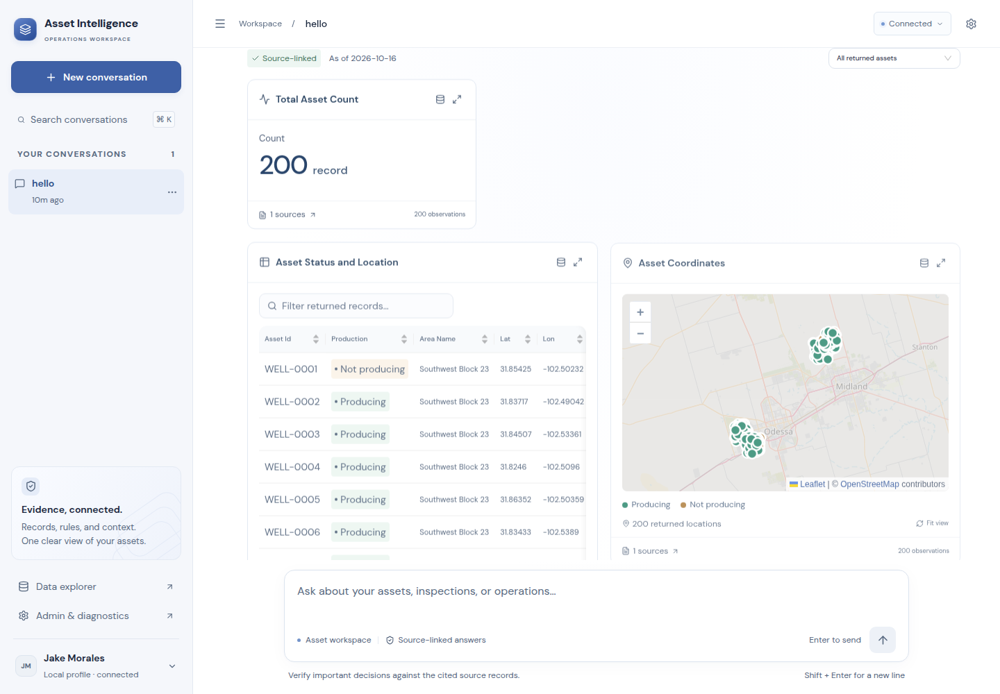
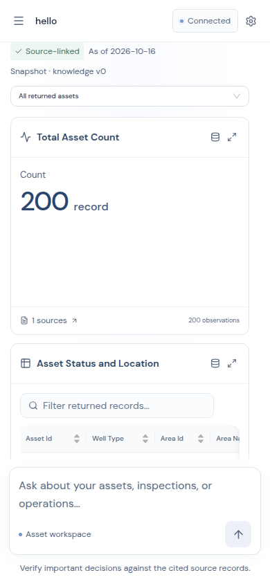
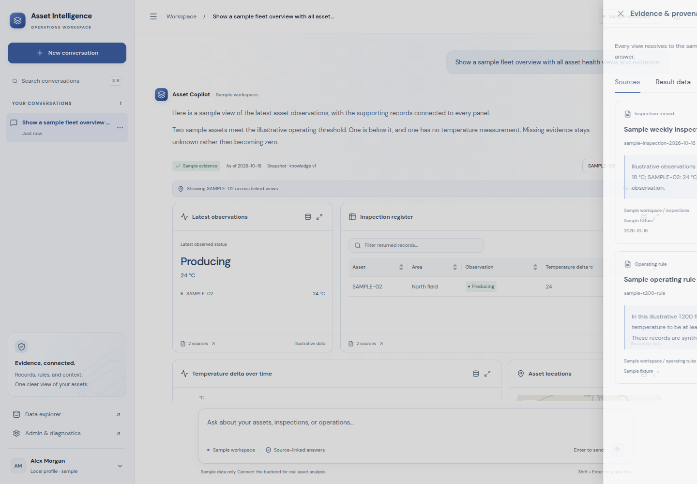
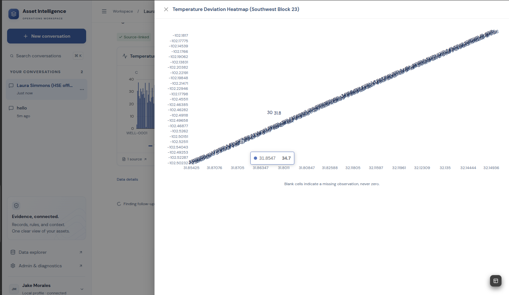
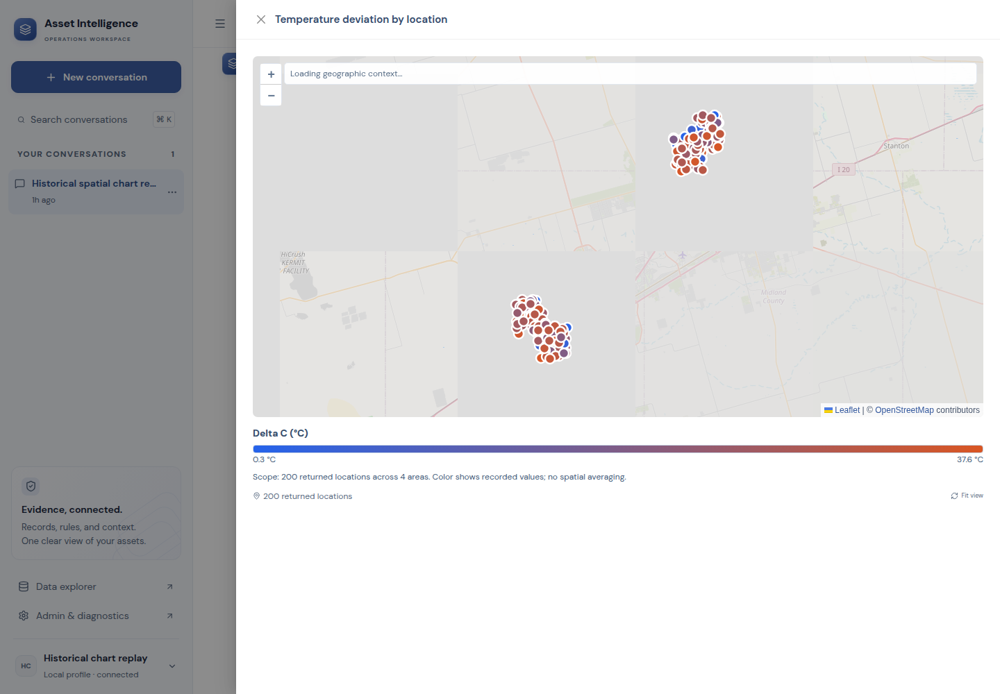
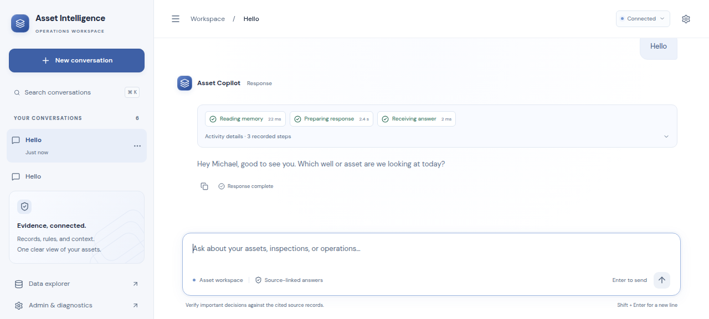
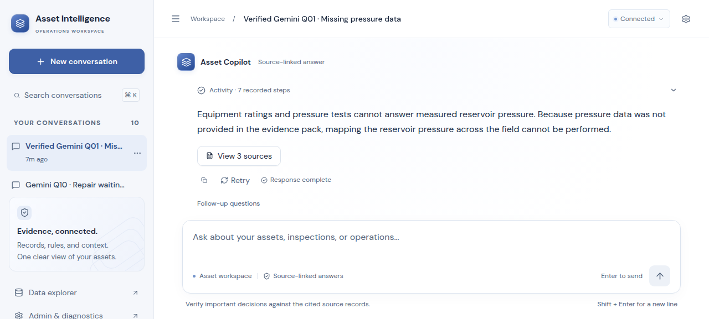
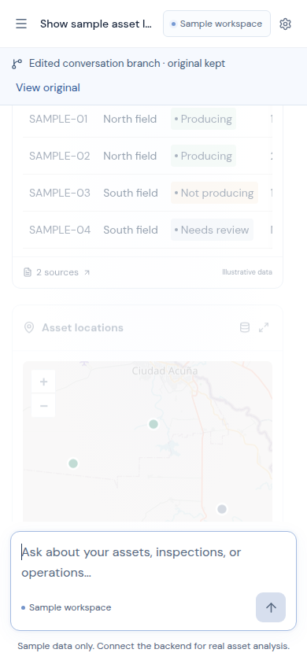
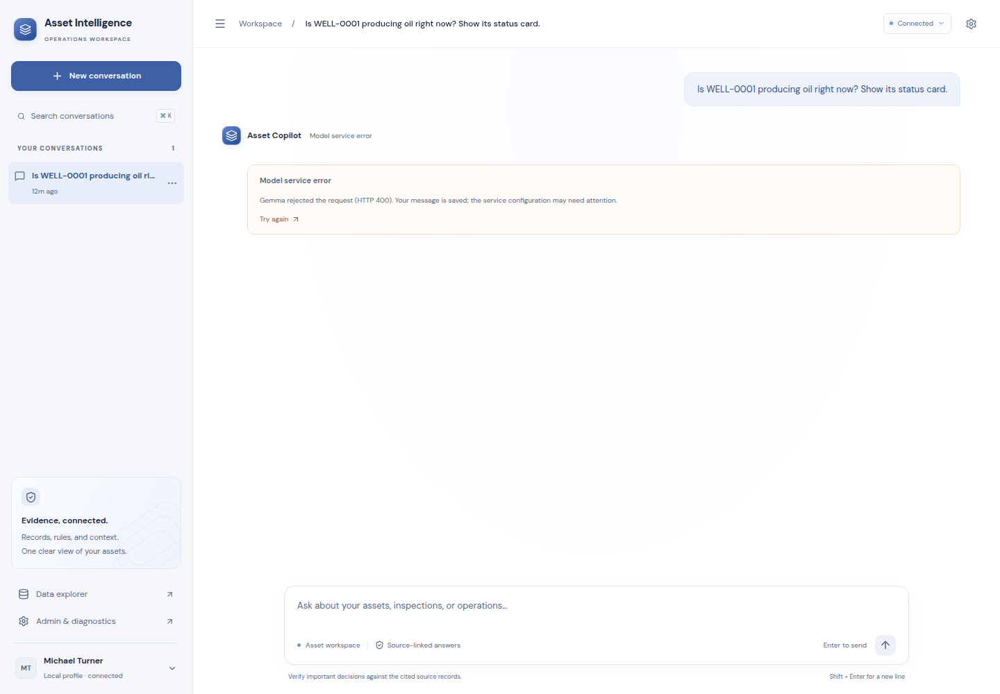
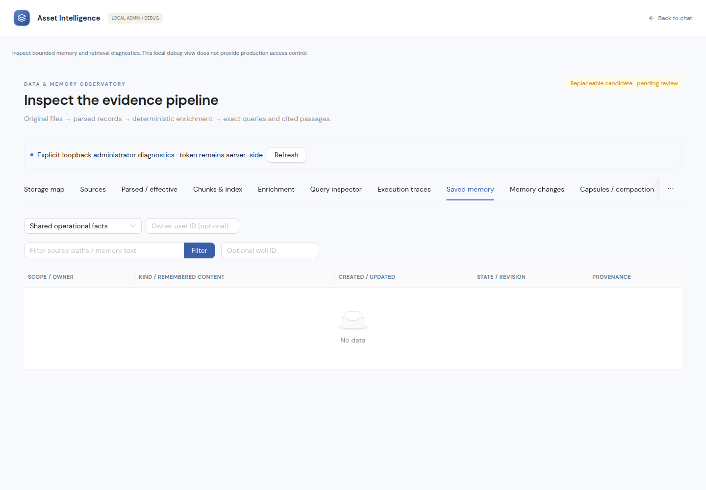

# Actual UI captures

Stable local preview: http://127.0.0.1:5192. These are actual browser captures. Sample, archived live and current source-only results are labeled separately; screenshots do not establish model accuracy.

## Readable desktop and mobile

The archived completed 200-asset fleet answer demonstrates the grid, correct aggregate count, production column, map and linked selection. Current dataset has600 assets; this screenshot is historical.

## Geographic heatmap correction

The same archived real numeric observations are replayed unchanged:200 locations across4 areas,0.3–37.6°C. The map reports that actual scope and does not claim interpolation.

## Actual current-model integration

The current600-asset Q1 answer reports missing pressure data and retains its three sources; no pressure values are invented.

## Historical failure and diagnostics

These captures preserve past integration failures and are not the current model state.

